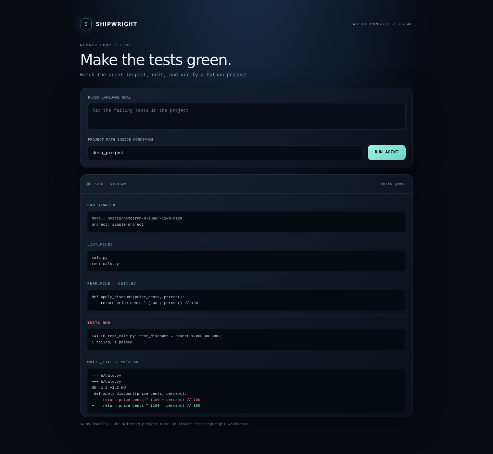

# Shipwright

An autonomous coding agent. Give it a Python project with failing tests and a goal in plain language. It reads the code, runs the test suite, edits files and re-runs the tests until they pass, then explains the fix. It runs on Nebius Token Factory and uses the NVIDIA Nemotron 3 Super open model (nvidia/nemotron-3-super-120b-a12b) through the OpenAI-compatible API, with native tool calling.

Track: Coding and Agentic Engineering (agents that write, run and test code in Token Factory).

## How it works
- The agent loop (shipwright/agent.py) gives the model four tools: list_files, read_file, write_file, run_tests.
- The sandbox (shipwright/sandbox.py) confines every file operation to the project root. Path escapes are rejected, and the test run has a timeout.
- The loop stops as soon as the model gives a final answer. A pass counts only if run_tests returned passed=true in that session. Otherwise the status is failed.

## Setup
    python -m venv .venv && source .venv/bin/activate
    pip install -r requirements.txt
    cp .env.example .env   # then paste your Nebius key (see SIGNUP_STEPS.md)
    export NEBIUS_API_KEY=your_key

## Run
    python -m pytest -q tests                 # offline tests, no key needed
    python -m shipwright.live_check           # live call to Token Factory
    python -m shipwright demo_project "make the failing tests in test_shop.py pass"

## Live UI

Launch the local streaming console from the repository root:

```bash
pip install -r requirements.txt
export NEBIUS_API_KEY=your_key
uvicorn shipwright.web:app --reload
```

Open http://127.0.0.1:8000, enter a goal and a project directory inside the workspace, and watch each tool call, file content or diff, and test output as the agent works. The existing `shipwright.agent.run_agent` loop is used unchanged. Set `SHIPWRIGHT_WORKSPACE` to a different allowed parent directory if needed. Runs are local and the project path is restricted to that workspace.



## Proof run

Run the reproducible agent trials from the repository root with a configured Nebius API key:

```bash
python scripts/run_proof.py
```

The runner creates four isolated projects under `proof_cases/`, captures the failing test result before the run, invokes the same `shipwright.agent.run_agent` loop, records elapsed wall time and tool steps, and runs pytest again afterward. Each trial must finish with the agent reporting `passed` and a fresh green pytest run. `proof_cases/results.json` contains the raw results. The public run summary and planted defects are in [PROOF.md](PROOF.md).

## Using NVIDIA models and Nebius
- Model: NVIDIA Nemotron 3 Super 120B (open weights), chosen for agentic tool use and long context.
- Serving: Nebius Token Factory, OpenAI-compatible endpoint at https://api.tokenfactory.nebius.com/v1/.
- Override the model with --model, for example nvidia/nemotron-3-nano-30b-a3b for a cheaper, faster loop.

## Third-party code
Built on the OpenAI Python SDK (Apache 2.0) and pytest (MIT). No other code is copied in.

## License
MIT. See LICENSE.
